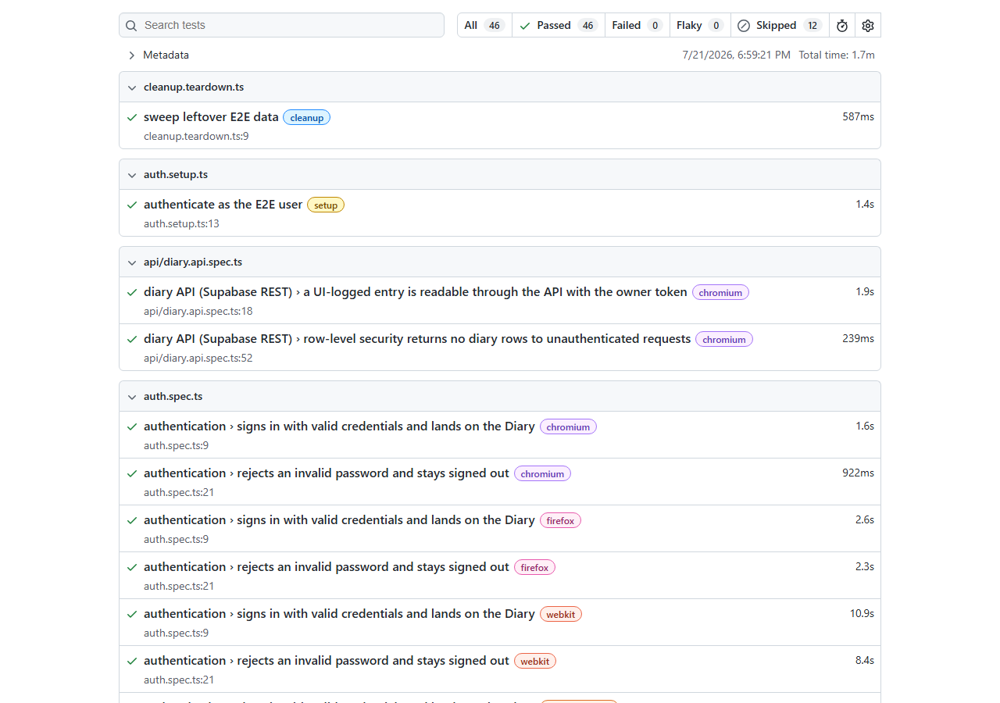

# FitLog E2E — Playwright Test Automation Framework

[](https://github.com/kakaul94-prof/fitlog-e2e/actions/workflows/e2e.yml)
[](https://kakaul94-prof.github.io/fitlog-e2e/)

End-to-end test automation for **[FitLog](https://github.com/kakaul94-prof/FitLog)** — a live
React 19 + Supabase PWA for tracking nutrition, strength, cardio, and body weight.
Built with **Playwright + TypeScript (strict)**, a **Page Object Model** architecture,
cross-browser + mobile projects, and **GitHub Actions CI** that publishes the HTML
report to GitHub Pages on every run.

[](https://kakaul94-prof.github.io/fitlog-e2e/)

## What this demonstrates

- **Page Object Model** — locators and interactions live in `pages/`; specs read like
  user scenarios (`await loginPage.signIn(email, password)`).
- **Custom fixtures** — `fixtures/test-options.ts` extends Playwright's `test` so every
  spec receives typed, ready-made page objects.
- **Authenticate once, reuse everywhere** — `tests/auth.setup.ts` signs in through the
  real UI and saves `storageState`; all browser projects start authenticated.
- **Cross-browser + mobile** — Chromium, Firefox, WebKit, and a Pixel 7 viewport
  (FitLog is phone-first).
- **CI/CD** — typecheck + lint + tests on every push/PR; HTML report deployed to
  GitHub Pages even when tests fail.
- **Web-first assertions, no sleeps** — role/label/text locators, auto-waiting
  `expect(locator)` assertions, zero `waitForTimeout`.

## Running locally

```sh
npm ci
npx playwright install
cp .env.example .env   # then fill in the test-account credentials
npm test               # full matrix
npm run test:chromium  # single browser while iterating
npm run report         # open the HTML report
```

Environment variables (see `.env.example`): `BASE_URL`, `E2E_EMAIL`, `E2E_PASSWORD`,
plus `SUPABASE_URL` / `SUPABASE_ANON_KEY` for the API specs. Locally they come from a
gitignored `.env`; in CI they are repository secrets. No secrets are ever committed.

## AI test agents (Playwright planner / generator / healer)

Playwright ships three Claude Code subagents plus an MCP server that lets them drive a
real browser through the test runner. They are set up here as an experiment. Anything
they write stays quarantined until a human reviews it.

**Setup (Playwright 1.61.1, Claude Code CLI)**

1. `npx playwright init-agents --loop=claude --project=chromium`. This writes
   `.claude/agents/playwright-test-{planner,generator,healer}.md`, `.mcp.json` (the
   `playwright-test` server, i.e. `npx playwright run-test-mcp-server`, which ships inside
   `@playwright/test` with nothing extra to install), a seed test and `specs/` for plans.
2. The generated seed moved to `tests/agents/seed.spec.ts` and now uses the suite's own
   fixtures (`fixtures/test-options`). The agents get the same signed-in per-worker
   account and REST client as a hand-written spec, and each session starts from a known
   state (`api.resetRehab()` for the Rehab area. Change it when you target another area).
3. Agent specs live in `tests/agents/` and run only in the opt-in `agents` project
   (desktop Chrome). The project exists only when `PW_AGENTS=1` is set, and `.mcp.json`
   sets that for the MCP server. The normal matrix and CI never see these specs.
4. `.mcp.json` is the Windows form (`cmd /c npx …`) as generated. On macOS/Linux use
   `"command": "npx", "args": ["playwright", "run-test-mcp-server"]`. The server opens
   a headed browser by default. Add `--headless` to its args for unattended runs.
5. Claude Code must be logged in (`claude`, then `/login`).

**Running them**

- Interactive: open Claude Code in the repo root, approve the `playwright-test` MCP
  server, then ask e.g. *"Use the playwright-test-planner agent to plan the Rehab centre.
  Seed: tests/agents/seed.spec.ts (project: agents). Save as specs/rehab.plan.md."*
- Headless (how the runs in this repo were made):

  ```sh
  claude -p "Use the playwright-test-planner agent to …" \
    --mcp-config .mcp.json --strict-mcp-config \
    --allowedTools mcp__playwright-test Read Glob Grep LS Agent \
    --output-format stream-json --verbose
  ```

  The healer also needs `Edit Write MultiEdit` in `--allowedTools`. If browsers are
  cached outside the default location, set `PLAYWRIGHT_BROWSERS_PATH`.
- Run the reviewed agent specs: `PW_AGENTS=1 npx playwright test --project=agents`.

Plans land in `specs/`. MCP snapshots land in `.playwright-mcp/` (gitignored).

## Coverage

| Area | Spec | Status |
|---|---|---|
| Authentication (positive, negative, sign-out) | `tests/auth.spec.ts` | ✅ |
| Offline PWA: cached reads + queued write sync | `tests/offline.spec.ts` | ✅ |
| Progression engine (deload, double progression, goal card) | `tests/progression.spec.ts` | ✅ |
| Navigation smoke (all tabs, no runtime errors) | `tests/navigation.spec.ts` | ✅ |
| Food diary logging + day totals (quick add, multi-add) | `tests/diary.spec.ts` | ✅ |
| Diary move/copy, day navigation, bulk delete | `tests/diary-move-copy.spec.ts` | ✅ |
| Streak healing via backfill | `tests/goals.spec.ts` | ✅ |
| Food search, manual + USDA import, rescale, soft-delete | `tests/food-search.spec.ts` | ✅ |
| Recipes (per-serving, recompute, unit conversion, duplicate) | `tests/recipe.spec.ts` | ✅ |
| Cardio (logged burn, MET estimate, edit with override) | `tests/cardio.spec.ts` | ✅ |
| Strength (sets, e1RM, prefills, supersets, records, exit flows) | `tests/strength.spec.ts` | ✅ |
| Nutrient breakdown (%DV, missing-data dashes) | `tests/nutrients.spec.ts` | ✅ |
| Body measurements (log, re-date, delete) | `tests/measurements.spec.ts` | ✅ |
| Streak indicator after logging today | with diary specs | ✅ |
| Diary entry editing (servings, meal) + delete | `tests/diary-entry.spec.ts` | ✅ |
| Saved meals (multi-select → save → relog) | `tests/meals.spec.ts` | ✅ |
| Calorie goal, eat-back credit, macro target modes | `tests/goals.spec.ts` | ✅ |
| Workout templates (targets persist, start workout) | `tests/routine.spec.ts` | ✅ |
| Accessibility: axe scan, login + all tabs | `tests/a11y.spec.ts` | ✅ |
| API: UI-insert → REST verify, RLS negative, row contract | `tests/api/diary.api.spec.ts` | ✅ |
| Backend-failure injection (USDA outage, transient 500 retry) | `tests/resilience.spec.ts` | ✅ |
| Log by weight (serving-unit picker) + just-added tray | `tests/diary.spec.ts` | ✅ |
| Reminders page (disabled web contract) | `tests/reminders.spec.ts` | ✅ |
| Rehab centre: create, pain re-rate, sessions, resolve/reopen, delete (agent-generated, reviewed; opt-in `agents` project) | `tests/agents/rehab.spec.ts` | 🧪 |

## Design decisions

- **Tests target a deployed environment** (`BASE_URL`), not a local build — the suite
  verifies what users actually receive, and the same suite can point at any
  environment via env var.
- **Dedicated test account** — Supabase Row-Level Security is owner-only on every
  table, so E2E data is fully isolated from real accounts.
- **Idempotent, self-cleaning data** — specs that write use per-run unique values
  (and unique past dates for day-total assertions, so parallel projects sharing the
  account never collide) and delete what they create via the Supabase REST API with
  the test user's own token. A teardown project sweeps anything a crashed run left
  behind.
- **`storageState` auth** — one real-UI login per run instead of one per test:
  faster, and auth flakiness is confined to a single setup project. The API client
  reuses that saved token too, so REST seeding/cleanup adds zero extra sign-ins.
- **Single-project gating where the matrix adds nothing** — the USDA import
  (external API), calorie-goal (one global profile row), and REST API specs run on
  desktop Chrome only, with the reason annotated at the skip.
- **Honest flake policy** — a remote target means occasional cold-start stalls:
  one local retry / two in CI, so genuine regressions fail while stalls surface as
  "flaky" in the report instead of being hidden.
- **CI watches the app, not just this repo** — a 6-hour cron plus a
  `repository_dispatch` fired by the FitLog repo on every dev push, with a
  concurrency group so runs never overlap on the shared accounts. A separate
  **timezone job** re-runs Chromium under `America/Chicago` to catch UTC-only
  date logic, and a **read-only prod canary** (`@readonly`-tagged auth, nav,
  axe, and RLS checks — zero writes) verifies the production site on scheduled
  runs.
- **Per-worker accounts (opt-in)** — with `E2E_EMAIL_W1..W3` configured, each
  Playwright worker signs into its own account via a REST-minted storageState,
  isolating account-global state between parallel workers; unset, all workers
  share the base account exactly as before.

## About the app under test

FitLog is a personal, phone-first fitness PWA (React 19, Vite, Tailwind v4, TanStack
Query, Supabase Postgres + Auth) — [repo](https://github.com/kakaul94-prof/FitLog) ·
[live app](https://fitlog-9wl.pages.dev). This framework lives in a separate repo, as
it would for an independent QA team.

## Future work

- Upstream accessibility fixes in the app, then shrink the axe known-violations
  allowlist to empty: the scan caught two real critical issues on Progress
  (unlabeled weight input, unnamed type select) and app-wide muted-text color
  contrast (rule disabled with a note until fixed).
- `data-testid` / `role="alert"` hooks in the app for the few elements that lack
  accessible handles (login error paragraph, streak pill, icon-only "+" buttons,
  set-row inputs) — each workaround is annotated in the page objects.
- Visual regression snapshots, API contract tests.
- Data-driven expansion: multiple meals/serving sizes per flow, macro-target
  assertions, strength goals + progression suggestions.
